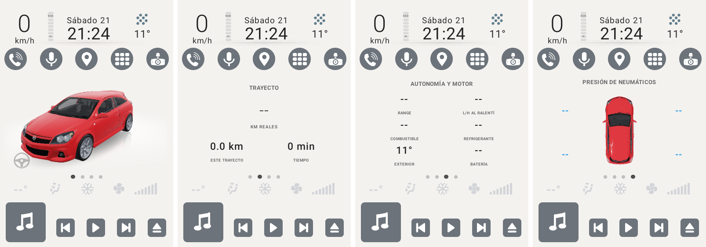
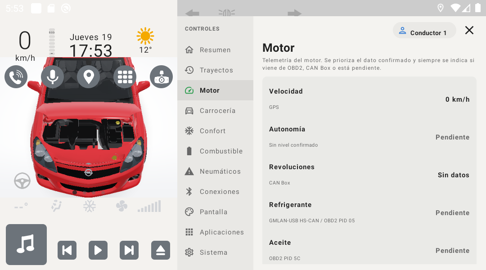
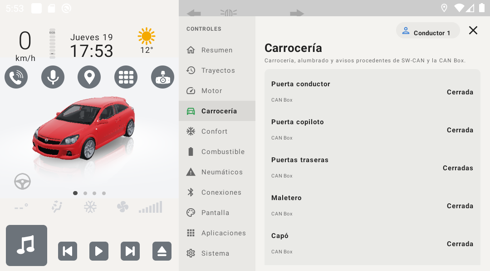
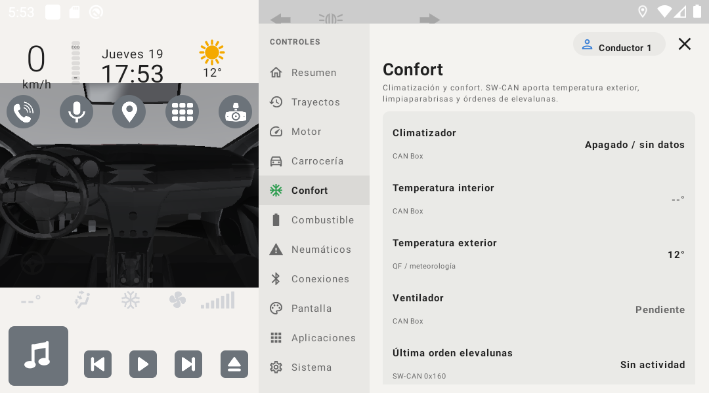
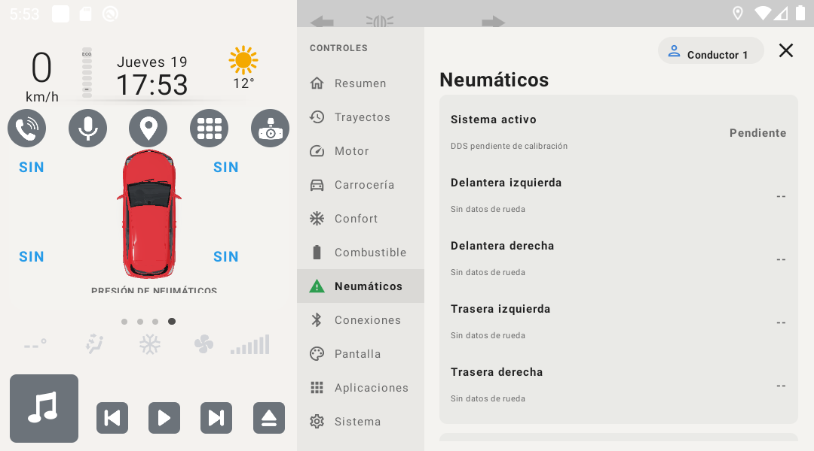
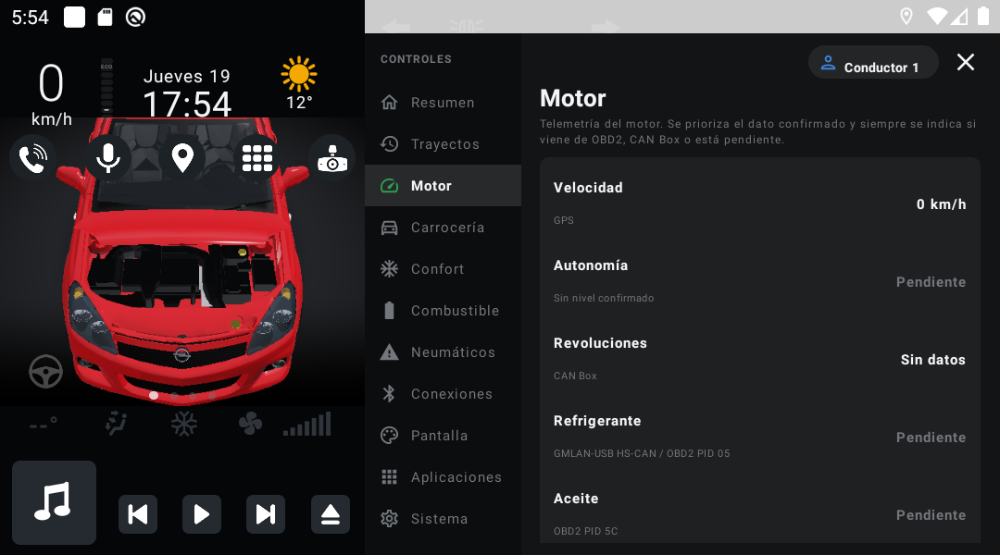
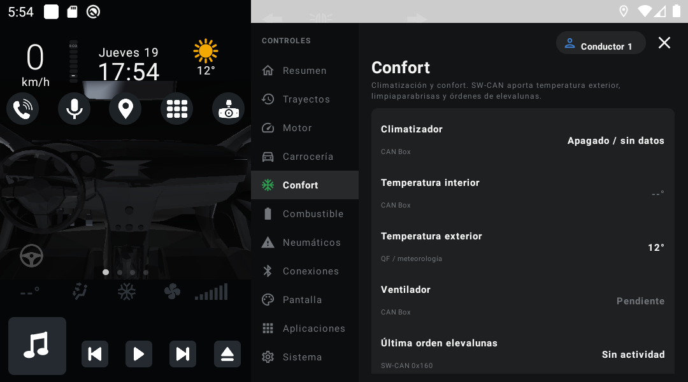
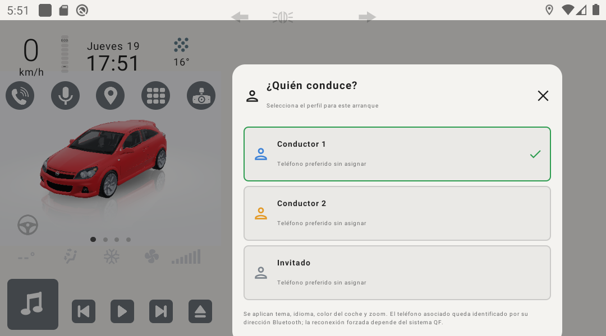
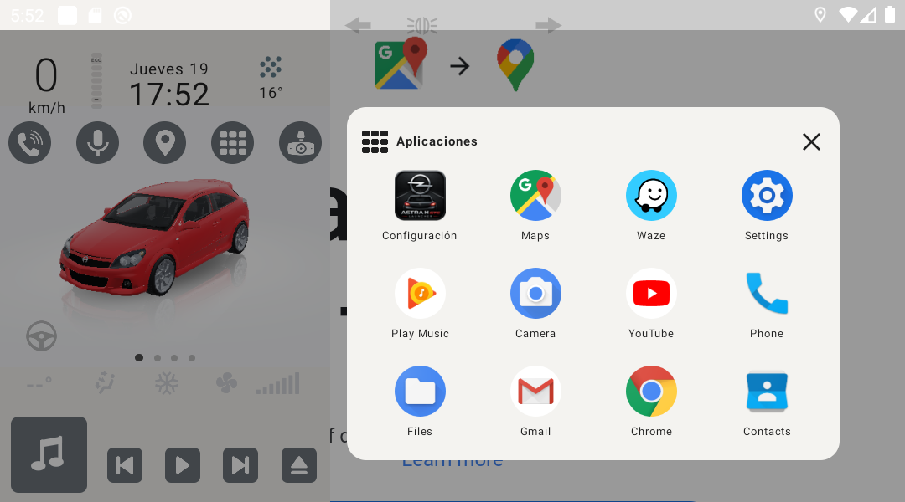
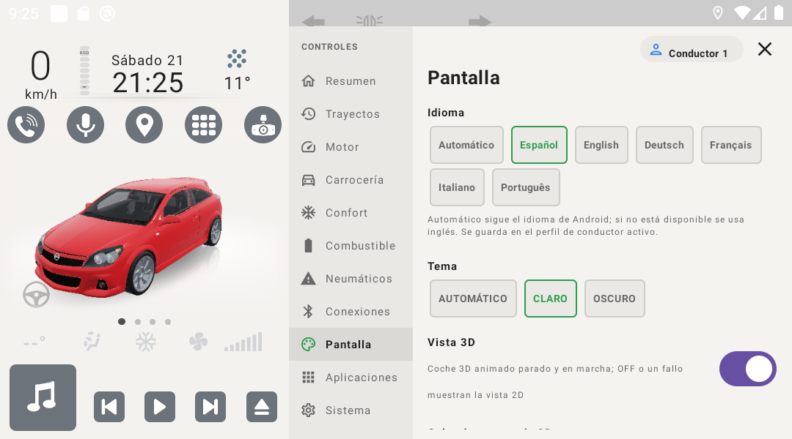

# Astra H Launcher

[English](README.md) · **Español**

[](https://github.com/Koretion/Astra-H-Launcher/actions/workflows/android.yml)
[](https://github.com/Koretion/Astra-H-Launcher/releases/latest)
[](#hardware)
[](#hardware)
[](CHANGELOG.md)
[](LICENSE)

Launcher Android para radios de coche. Sustituye la pantalla de inicio por un panel fijo con los
datos del vehículo, el clima, la multimedia y el teléfono, y deja el resto de la pantalla a una
aplicación Android como Google Maps o Waze (totalmente compatible). No modifica el firmware de la
radio ni necesita root.

Es un APK normal, así que se instala en cualquier radio con Android 10 o superior. Los datos del
vehículo llegan de una o varias fuentes opcionales: la información QF de la radio (CAN box de la
TS10), un adaptador OBD2 ELM327 y/o el capturador GMLAN-USB (recomendado).

> [!IMPORTANT]
> Solo se ha probado en una **radio TS10 (firmware QF) en un Opel Astra H**. En otras radios no
> estarán las integraciones QF (clima, puertas, radio FM), y las señales CAN que decodifica
> el GMLAN-USB son las del Astra H. Con otro coche siguen funcionando los datos OBD2 estándar a
> través del ELM327.

Versión actual: **0.5.2** (`versionCode 63`). Cambios en [CHANGELOG.md](CHANGELOG.md).

## Capturas

Tomadas en el emulador de Android, por eso no hay datos reales del vehículo (`--` / *Sin datos*).

<p align="center">
  
</p>

| | |
| :---: | :---: |
|  |  |
| Motor: el coche 3D abre el capó | Carrocería: puertas, maletero y capó |
|  |  |
| Confort: vista del interior | Presión de neumáticos |
|  |  |
| Tema oscuro | Tema oscuro |
|  |  |
| ¿Quién conduce?: perfiles de conductor | Cajón de aplicaciones |
|  | |
| Pantalla: idioma, tema y vista 3D | |

## Qué ofrece

- **Pantalla de inicio híbrida:** panel izquierdo fijo y aplicación Android a la derecha, con
  restauración tras HOME, Recientes, llamadas y aplicaciones a pantalla completa.
- **Vehículo:** velocidad, RPM, temperaturas, batería, puertas, cierre, luces, intermitentes,
  freno de mano, autonomía y consumo, con una vista 3D del coche que refleja su estado.
- **Clima y multimedia:** climatización de la radio, radio FM, sesiones multimedia de Android y
  Spotify.
- **Teléfono:** llamadas Bluetooth a través de la radio.
- **Conducción:** límite de velocidad y contexto vial desde OpenStreetMap, aviso sonoro de
  velocidad y meteorología de Open-Meteo.
- **Cámaras y visión:** cámara USB o dashcam, y una ayuda visual local con detección de objetos
  y carriles. Es **informativa**, no un sistema ADAS.
- **Trayectos:** registro local en SQLite y subida opcional a una hoja de Google Sheets propia.
- **Perfiles de conductor** reconocidos por la llave de contacto (con el GMLAN-USB).
- **Idiomas:** español, inglés, alemán, francés, italiano y portugués; automático según Android o
  elegido por conductor.
- **Actualizaciones:** comprueba GitHub Releases para nuevas versiones del launcher y del firmware
  GMLAN-USB; solo avisar, descargar y avisar, o instalar sin avisar con el coche parado.
- **Diagnóstico:** monitor de datos, exportación de informes y captura CAN.

No todas las funciones tienen el mismo grado de validación en el coche. Los cambios y su estado
están en el [historial de cambios](CHANGELOG.md).

## Hardware

Solo es imprescindible la radio. Cada fuente de datos es opcional y el launcher muestra lo que
cada una puede aportar.

| Elemento | Necesario | Aporta |
| --- | --- | --- |
| Radio con Android 10 o superior | Sí | Base del launcher. Probado en una TS10 con firmware QF |
| Información QF (CAN box de la TS10) | No | Clima y puertas desde la CAN box, y radio FM, en radios TS10 |
| Adaptador OBD2 ELM327 Bluetooth | No | RPM, velocidad, temperatura, caudal de aire y consumo estimado, en cualquier coche con OBD2 |
| Capturador GMLAN-USB (ESP32-C3) | Recomendado | Lectura pasiva de HS-CAN, MS-CAN y SW-CAN en el Astra H: odómetro, combustible, luces, cierre, llaves, neumáticos… |
| Cámara USB o dashcam compatible | No | Imagen para la cámara y la ayuda visual |
| Receptor TPMS USB | No | Presión de neumáticos |

> [!NOTE]
> El **GMLAN-USB** es un proyecto propio independiente, también en desarrollo y todavía en fase de
> pruebas. Funciona **solo en escucha**: no transmite nada al coche. Cuando esté probado se
> añadirá aquí el enlace al proyecto, con sus planos, documentación y firmware.

> [!NOTE]
> Se irán añadiendo más datos OBD2 y tramas CAN reconocidas conforme avance la investigación.

## Instalación

1. Instala el APK en la radio (desde [Releases](../../releases)).
2. Selecciónalo como aplicación de inicio (HOME) cuando Android lo pida.
3. Concede el permiso para mostrarse sobre otras aplicaciones y los permisos de ubicación,
   Bluetooth y notificaciones.
4. En **Ajustes** del launcher elige las aplicaciones del panel derecho y activa las fuentes de
   datos que tengas instaladas.

## Compilación

Requisitos: JDK 17 y Android SDK 34.

```powershell
.\gradlew.bat testDebugUnitTest   # pruebas unitarias
.\gradlew.bat assembleDebug       # APK de depuración
.\gradlew.bat assembleRelease     # APK de entrega (R8)
```

El APK de depuración queda en `app/build/outputs/apk/debug/app-debug.apk`. Ambos builds se firman
con tu clave de depuración local de Android, así que un APK compilado por ti no se puede instalar
encima del oficial: desinstala antes el oficial.

```text
app/        Aplicación y pruebas unitarias
docs/       Capturas del README y el script de Google Sheets para los trayectos
```

## Documentación

- [Registro de trayectos con Google Sheets](docs/google-sheets/README.es.md): subida opcional de
  los trayectos a una hoja propia, con avisos por Telegram.

## Seguridad y limitaciones

> [!CAUTION]
> Usar el launcher mientras se conduce es responsabilidad de quien conduce. La ayuda visual es
> solo informativa.

- La ayuda visual no es un ADAS certificado y no actúa sobre el vehículo.
- Las integraciones con el firmware QF son específicas de las radios TS10 y pueden variar entre
  versiones de firmware.

## Licencia

Este proyecto se publica con la [Licencia Pública General de GNU v3.0](LICENSE). Puedes usarlo,
estudiarlo, modificarlo y redistribuirlo; si distribuyes una versión modificada, debes publicar su
código fuente con la misma licencia.

El modelo de detección de objetos incluido, `yolov8n_320_int8.tflite`, procede de Ultralytics
YOLOv8 y tiene licencia AGPL-3.0, compatible con la GPL-3.0.

Opel y Astra son marcas de sus respectivos titulares. Este proyecto es independiente y no está
afiliado ni respaldado por ellos.
