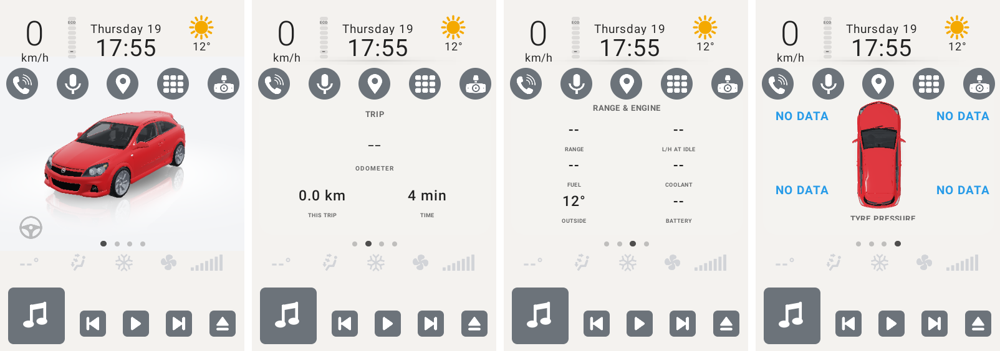
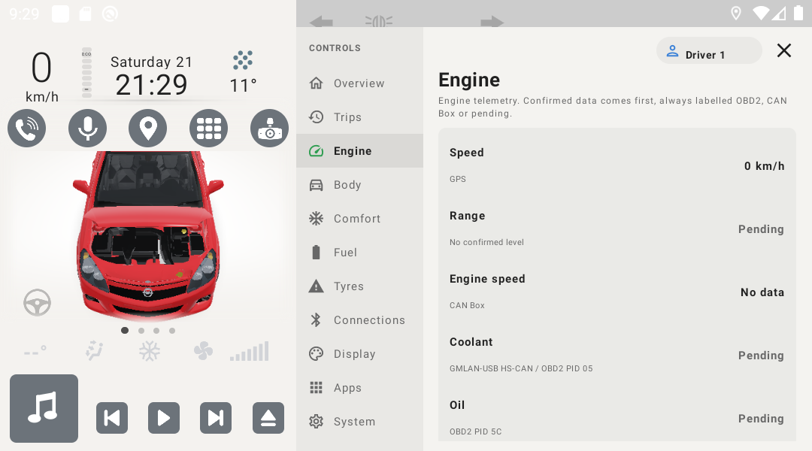
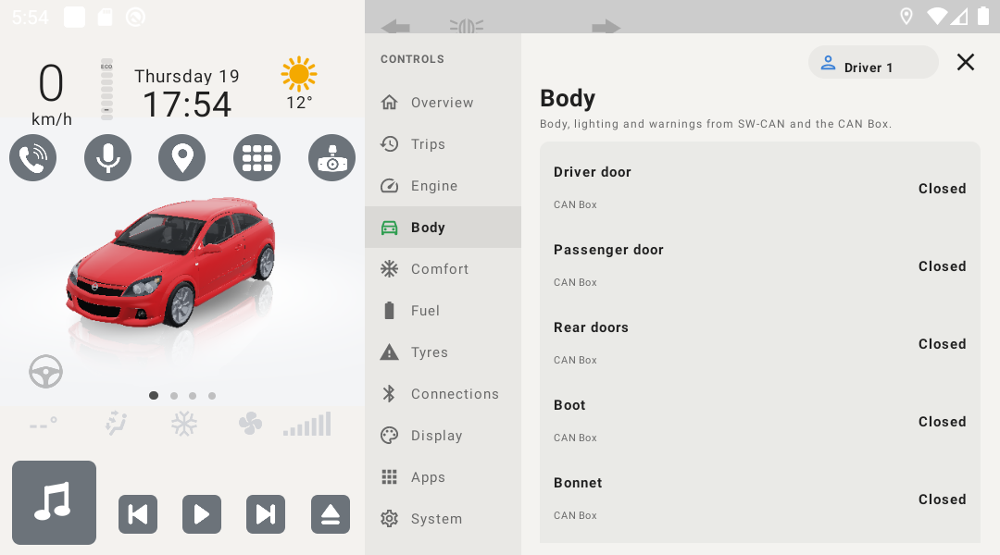
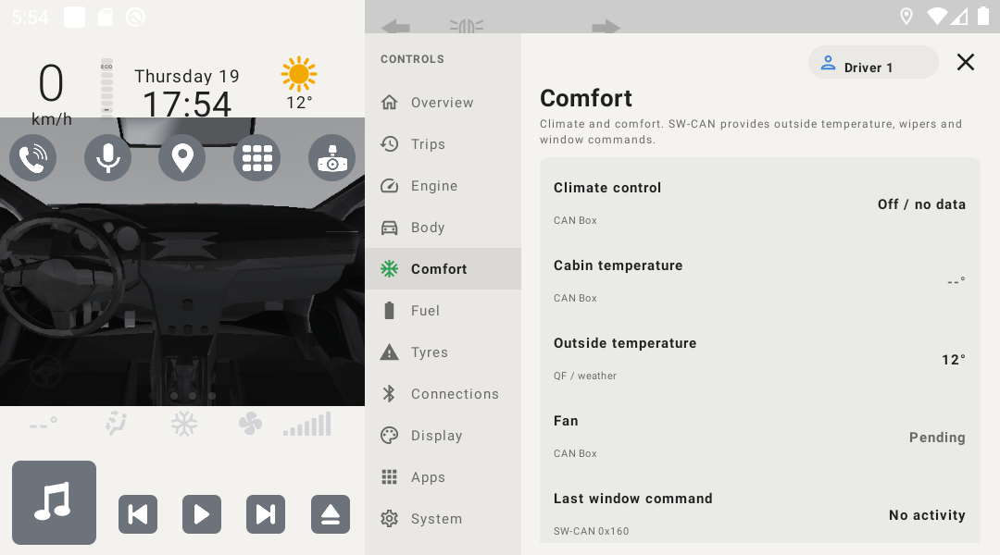
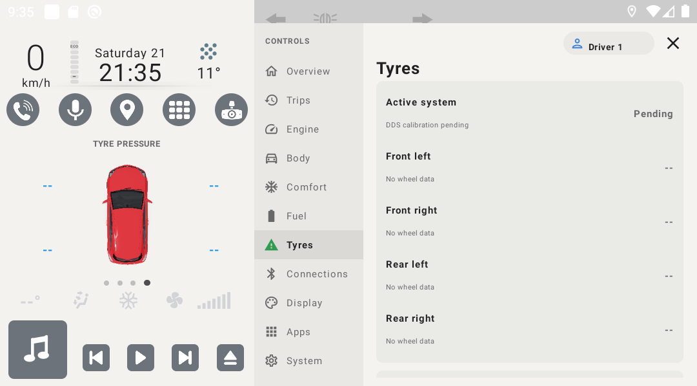
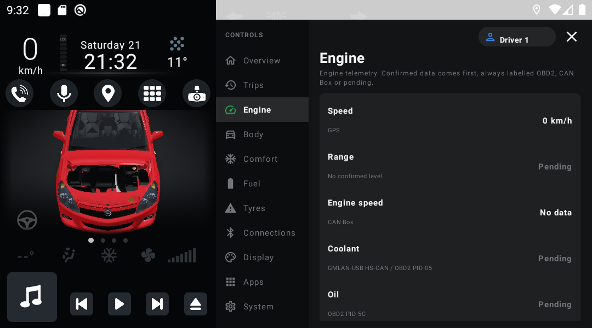
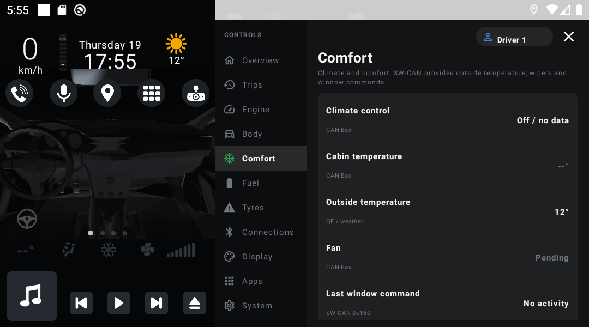
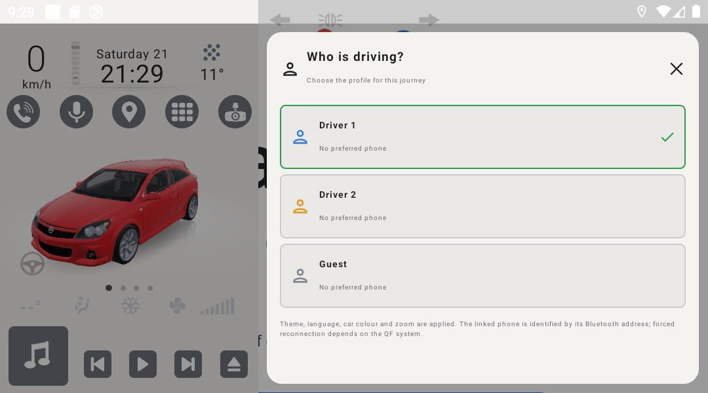
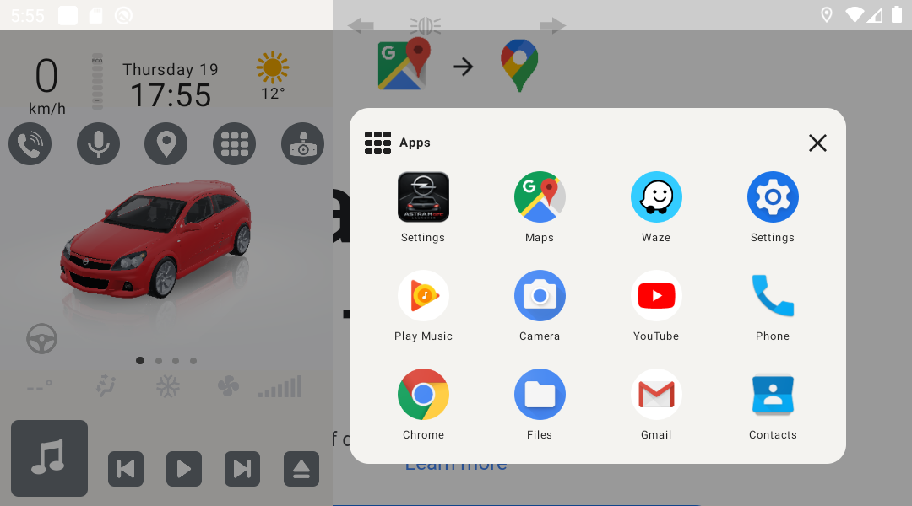
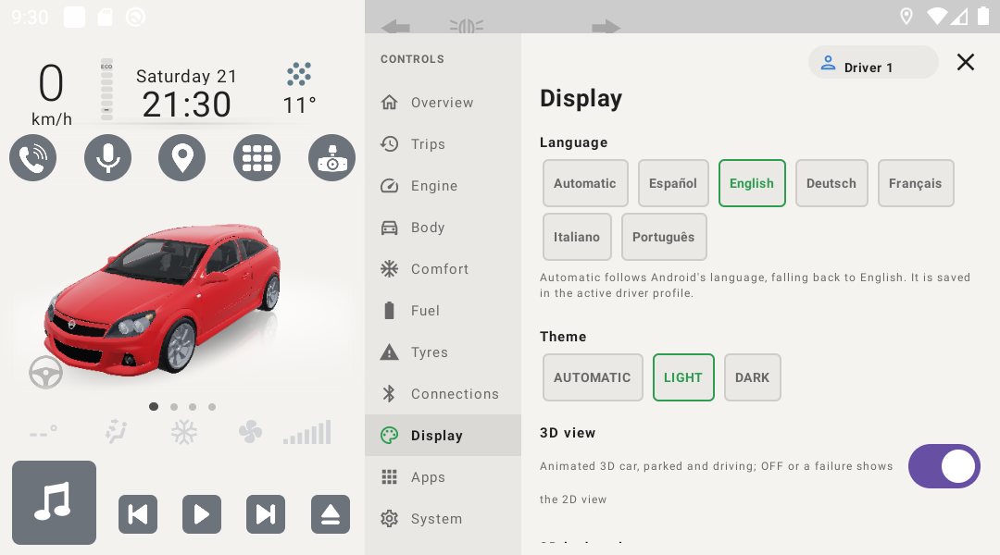

# Astra H Launcher

**English** · [Español](README.es.md)

[](https://github.com/Koretion/Astra-H-Launcher/actions/workflows/android.yml)
[](https://github.com/Koretion/Astra-H-Launcher/releases/latest)
[](#hardware)
[](#hardware)
[](CHANGELOG.md)
[](LICENSE)

An Android home-screen launcher for car head units. It replaces the home screen with a fixed
panel showing vehicle data, climate, media and phone, and leaves the rest of the screen to a
regular Android app such as Google Maps or Waze (fully compatible). It does not modify the head
unit's firmware and does not need root.

It is a regular APK, so it installs on any Android 10+ head unit. The vehicle data comes from one
or more optional sources: the head unit's QF information (TS10 CAN box), an ELM327 OBD2 adapter
and/or the GMLAN-USB sniffer (recommended).

> [!IMPORTANT]
> It has only been tested on a **TS10 head unit (QF firmware) in an Opel Astra H**. On other
> head units the QF integrations (climate, doors, FM radio) will not be available, and the
> CAN signals decoded by the GMLAN-USB are those of the Astra H. With another car, standard OBD2
> data still works through the ELM327.

Current version: **0.5.3** (`versionCode 64`). See [CHANGELOG.md](CHANGELOG.md).

## Screenshots

Taken on the Android emulator, so there is no live vehicle data (`--` / *No data*).

<p align="center">
  
</p>

| | |
| :---: | :---: |
|  |  |
| Engine — the 3D car opens the bonnet | Body — doors, boot and bonnet |
|  |  |
| Comfort — interior view | Tyre pressure |
|  |  |
| Dark theme | Dark theme |
|  |  |
| Who is driving? — driver profiles | App drawer |
|  | |
| Display — language, theme and 3D view | |

## Features

- **Hybrid home screen:** fixed left panel with an Android app on the right, restored after
  HOME, Recents, calls and full-screen apps.
- **Vehicle:** speed, RPM, temperatures, battery, doors, locking, lights, indicators, handbrake,
  range and consumption, with a 3D car that mirrors its state.
- **Climate and media:** the head unit's climate control, FM radio, Android media sessions and
  Spotify.
- **Phone:** Bluetooth calls through the head unit.
- **Driving:** speed limit and road context from OpenStreetMap, speed warning chime and weather
  from Open-Meteo.
- **Cameras and vision:** USB camera or dashcam, and an on-device visual aid with object and lane
  detection. It is **informational only**, not an ADAS.
- **Trips:** local SQLite log and optional upload to your own Google Sheets spreadsheet.
- **Driver profiles**, recognised by the ignition key (with the GMLAN-USB).
- **Languages:** English, Spanish, German, French, Italian and Portuguese; follows Android
  automatically or can be chosen per driver.
- **Updates:** checks GitHub Releases for new launcher versions and for the GMLAN-USB firmware;
  notify only, download and notify, or install silently while parked.
- **Diagnostics:** data monitor, report export and CAN capture.

Not every feature has been validated in the car to the same degree. Changes and their status
are listed in the [changelog](CHANGELOG.md).

## Hardware

Only the head unit is required. Every data source is optional and the launcher shows whatever
each one can provide.

| Item | Required | Provides |
| --- | --- | --- |
| Android 10+ head unit | Yes | Launcher base. Tested on a TS10 with QF firmware |
| QF information (TS10 CAN box) | No | Climate and doors from the CAN box, and FM radio, on TS10 units |
| ELM327 Bluetooth OBD2 adapter | No | RPM, speed, temperature, air flow and estimated consumption, on any OBD2 car |
| GMLAN-USB sniffer (ESP32-C3) | Recommended | Passive HS-CAN, MS-CAN and SW-CAN reading on the Astra H: odometer, fuel, lights, locking, keys, tyres… |
| Compatible USB camera or dashcam | No | Image for the camera and the visual aid |
| USB TPMS receiver | No | Tyre pressure |

> [!NOTE]
> **GMLAN-USB** is a separate project of our own, also in active development and still being
> tested. It is **listen-only**: it never transmits to the car. Once it has been validated, a link
> to the project will be added here, with its schematics, documentation and firmware.

> [!NOTE]
> More OBD2 data and recognised CAN frames will be added as the research continues.

## Installation

1. Install the APK on the head unit (from [Releases](../../releases)).
2. Select it as the home app (HOME) when Android asks.
3. Grant the *display over other apps* permission and the location, Bluetooth and notification
   permissions.
4. In the launcher's **Settings**, choose the apps for the right-hand side and enable the data
   sources you have installed.

## Building

Requirements: JDK 17 and Android SDK 34.

```powershell
.\gradlew.bat testDebugUnitTest   # unit tests
.\gradlew.bat assembleDebug       # debug APK
.\gradlew.bat assembleRelease     # release APK (R8)
```

The debug APK ends up in `app/build/outputs/apk/debug/app-debug.apk`. Both builds are signed
with your local Android debug key, so an APK you build cannot be installed over the official
release: uninstall it first.

```text
app/        Application and unit tests
docs/       CAN signal table, README screenshots and the Google Sheets trip-tracking script
```

## Documentation

- [CAN signals](docs/CAN_SIGNALS.md): every CAN frame the launcher uses, its validation status
  and how to contribute signals from other cars.
- [Trip tracking with Google Sheets](docs/google-sheets/README.md): optional upload of your trips
  to your own spreadsheet, with Telegram notifications.

## Safety and limitations

> [!CAUTION]
> Using the launcher while driving is the driver's responsibility. The visual aid is
> informational only.

- The visual aid is not a certified ADAS and does not act on the vehicle.
- Integrations with the QF firmware are specific to TS10 head units and may vary between firmware
  versions.

## License

This project is licensed under the [GNU General Public License v3.0](LICENSE). You may use,
study, modify and redistribute it; if you distribute a modified version, you must publish its
source code under the same license.

The bundled object-detection model `yolov8n_320_int8.tflite` comes from Ultralytics YOLOv8 and is
licensed under AGPL-3.0, which is compatible with GPL-3.0.

Opel and Astra are trademarks of their respective owners. This project is independent and is not
affiliated with or endorsed by them.
